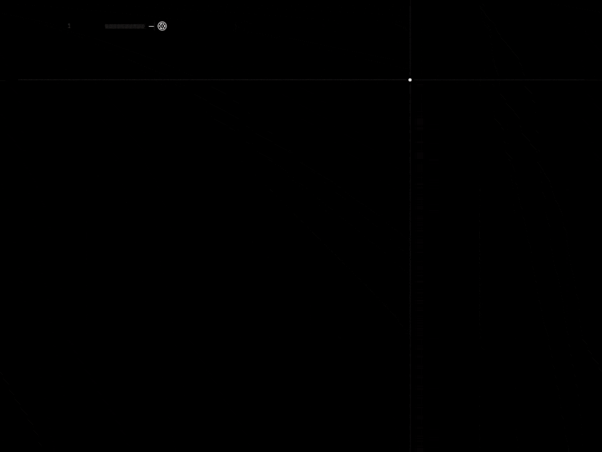

# Spaceship

Steer your ideas in realtime, spaceship pilot style!

A design concept that explores new interaction patterns as LLM and Decision Models approaches 60 FPS.

1. **Focus monitor**: can we visualize what LLM is paying attention to, and use that to guide human's focus towards what's important?
2. **Attention lock**: can we force LLM to pay more attention to specific phrases so as to bias its future behavior?
3. **Future Vector Steering**: can we decompose the task into eigenvectors and independently tune each to control steer the text generation?
4. **Realtime re-generation**: when text generation is cheap and fast, can we explore alternative futures by scrubbing?
